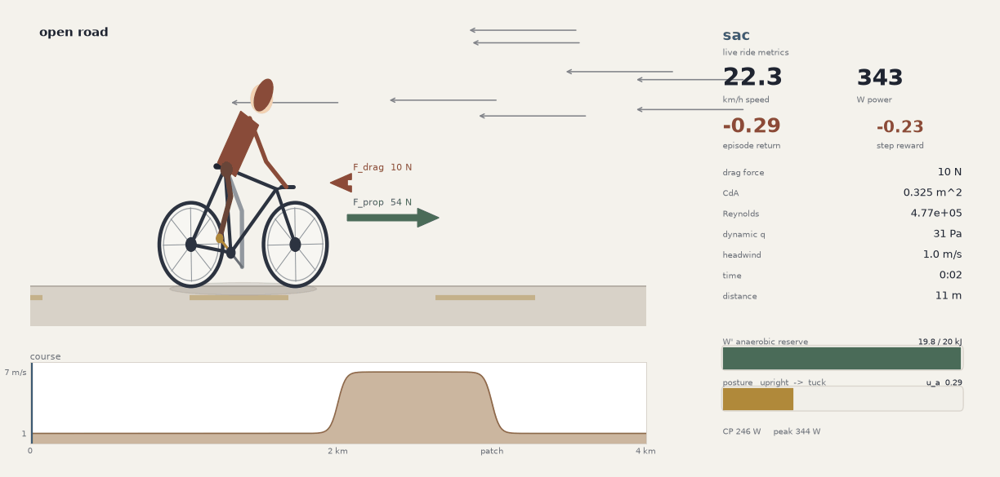

# bikesim

A cyclist riding through a spatial wind field. The rider jointly chooses
power and posture (upright to tuck). A SAC policy spends anaerobic reserve
in the headwind patch, where each watt removes the most drag.

SAC ride on the 4 km course (24× speed):

The HUD shows speed, power, episode return, step reward, drag, CdA, Reynolds
number, headwind, `W'`, and posture. Sage / rust arrows are `F_prop` and
`F_drag`.
